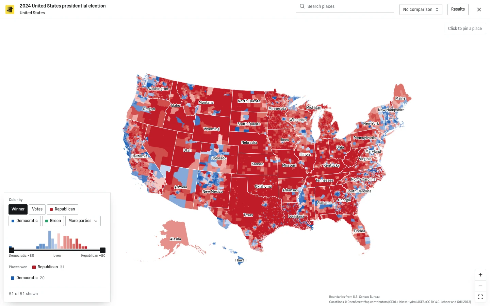

<p align="center">
  <a href="https://electionsarchive.com"></a>
</p>

<h1 align="center">Elections Archive</h1>

<p align="center">Every election in the world, down to the ballot box, with every number traced to its source.</p>

<p align="center">
  <a href="https://electionsarchive.com">Website</a> ·
  <a href="https://electionsarchive.com/agents">For agents</a> ·
  <a href="https://electionsarchive.com/api/v1/openapi.json">API</a> ·
  <a href="https://electionsarchive.com/downloads">Downloads</a> ·
  <a href="https://electionsarchive.com/coverage">Coverage</a>
</p>

<br>

Elections Archive collects election results from each country's first election to its latest, down to the smallest unit that the official count reports, such as a precinct, a polling station, or a ballot box. One database serves the website, a REST API, an MCP server, Markdown and JSON versions of every page, and bulk downloads.

<p align="center">
  
</p>

- **Sourced.** Every number links to the source that published it and to the change that brought it into the archive. Figures read from scanned books keep the page and the position on the page they came from.
- **Stored as declared.** Official winners and seats are stored as the authority declared them. A seat engine recomputes them only to compare, and never overwrites them.
- **Open.** The code is free software, the data is free to reuse with credit, and anyone can report a mistake.

The [coverage page](https://electionsarchive.com/coverage) shows which countries and years the archive holds and what is still missing.

## Use it

### In a browser

Start at [electionsarchive.com](https://electionsarchive.com). Addresses follow the place, then the election, then the contest, then the reporting unit, as in [`/us/ga/2020-11-03-general/senate/fulton-county-ga`](https://electionsarchive.com/us/ga/2020-11-03-general/senate/fulton-county-ga).

### As Markdown or JSON

Add `.md` or `.json` to any page's address, or send an `Accept: text/markdown` or `Accept: application/json` header. Links in the Markdown lead to other Markdown pages, and [`/llms.txt`](https://electionsarchive.com/llms.txt) maps the whole site.

```bash
curl https://electionsarchive.com/us/2024-11-05-general/president.md
```

### With an agent

Install the skill, which teaches an agent the archive's data model, its addresses, and its tools:

```bash
npx skills add electarchive/electionsarchive
```

Or connect the MCP server at `https://electionsarchive.com/mcp`, which speaks streamable HTTP. In Claude Code:

```bash
claude mcp add --transport http electionsarchive https://electionsarchive.com/mcp
```

[Connect your agent](https://electionsarchive.com/agents) has setup steps for other clients, the full list of tools, and example questions.

### Through the API

The REST API is at `https://electionsarchive.com/api/v1`, and its [OpenAPI description](https://electionsarchive.com/api/v1/openapi.json) lists every endpoint. Each MCP tool has a matching REST endpoint.

```bash
curl "https://electionsarchive.com/api/v1/search?q=istanbul"
```

Reading needs no key and no account. A key from [your settings](https://electionsarchive.com/settings/keys) raises your rate limits; send it in the `x-api-key` header.

### In bulk

[Downloads](https://electionsarchive.com/downloads) has the whole archive as data files that you can query offline.

## Run it locally

The archive is a SvelteKit app over one Postgres and PostGIS database, which Python pipelines fill from official sources. [CONTRIBUTING.md](CONTRIBUTING.md) covers setup, loading real data, and the checks to run before a pull request. To see how the pieces fit, read [architecture](docs/architecture.md), [data model](docs/data-model.md), and [pipelines](docs/pipelines.md).

## Contribute

To fix a wrong number, name, or boundary, open a [data error issue](https://github.com/electarchive/electionsarchive/issues/new?template=data-error.yml) and cite a source that shows the right value. To suggest a source the archive doesn't have yet, open a [new source issue](https://github.com/electarchive/electionsarchive/issues/new?template=new-source.yml). Code comes in through pull requests, as described in [CONTRIBUTING.md](CONTRIBUTING.md). Report security issues privately, as described in [SECURITY.md](SECURITY.md).

## License and citation

The code is licensed under the [GNU Affero General Public License v3.0](LICENSE). The data is published under [CC BY 4.0](https://creativecommons.org/licenses/by/4.0/), except where a source's own license differs, and each result set records its source's license. To cite the archive, use a format from the [license page](https://electionsarchive.com/license), and credit the source of any figures you rely on.
