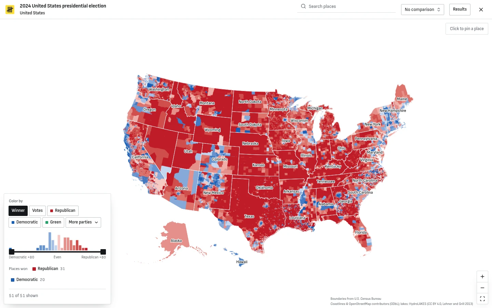
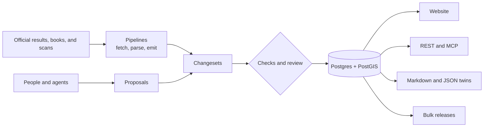

<div align="center">


# Elections Archive

**Every election in the world, down to the ballot box.**

[](https://github.com/electionsarchive/electionsarchive/actions/workflows/ci.yml)
[](LICENSE)
[](https://creativecommons.org/licenses/by/4.0/)
[](https://electionsarchive.com/agents)

[Website](https://electionsarchive.com) · [API](https://electionsarchive.com/api/v1/openapi.json) · [For agents](https://electionsarchive.com/agents) · [Docs](docs/architecture.md) · [Contributing](CONTRIBUTING.md)

</div>

<br>

<p align="center">
  
</p>

Elections Archive holds results for more than 900,000 contests, from the 1787 elections in the United States to this year's, by precinct, polling station, and ballot box where the official count goes that deep. Every number links to the source that published it.

- **Every number has a receipt.** Each figure traces to a source and to the changeset that wrote it. Figures read from scanned books keep the page and the box on that page they came from.
- **Down to the finest unit.** Precincts in the US, ballot boxes in Türkiye, polling stations in France, sections in Brazil, and polling districts in Germany.
- **Declared, then checked.** Official winners and seats are stored as declared. A seat engine, tested against real elections, recomputes them for comparison and never overwrites them.
- **Built for agents.** Every page is also Markdown and JSON, the REST API is described by OpenAPI, and an MCP server exposes the same tools.
- **Open to corrections.** Anyone can propose a fix with a citation. Proposals, evidence, and decisions are public.

## What's inside

| Country           | Since | Finest unit       |
| ----------------- | ----- | ----------------- |
| 🇺🇸 United States  | 1787  | precinct          |
| 🇬🇧 United Kingdom | 1832  | ward              |
| 🇨🇭 Switzerland    | 1848  | commune           |
| 🇨🇦 Canada         | 1867  | polling division  |
| 🇹🇷 Türkiye        | 1923  | ballot box        |
| 🇮🇹 Italy          | 1948  | polling section   |
| 🇩🇪 Germany        | 1949  | polling district  |
| 🇫🇷 France         | 1958  | polling station   |
| 🇪🇺 European Union | 1979  | member state      |
| 🇮🇪 Ireland        | 1979  | Dáil constituency |
| 🇧🇷 Brazil         | 1994  | section           |

Depth varies by country and year. The [coverage page](https://electionsarchive.com/coverage) measures each country against an outside count of its elections and lists what is still missing.

## Use it

Add `.md` or `.json` to any page:

```bash
curl https://electionsarchive.com/us/2024-11-05-general/president.md
```

Search and query through REST:

```bash
curl "https://electionsarchive.com/api/v1/search?q=istanbul"
```

Connect an agent over MCP. Reading needs no key; proposing changes needs one from [your settings](https://electionsarchive.com/settings/keys).

```json
{
  "mcpServers": {
    "electionsarchive": {
      "type": "http",
      "url": "https://electionsarchive.com/mcp"
    }
  }
}
```

## How it works



One database is the source of truth, and the only way to write to it is a changeset. Pipelines and people produce changesets the same way, and every changeset passes the same checks before it is published. Read more in [docs/architecture.md](docs/architecture.md), [docs/data-model.md](docs/data-model.md), and [docs/pipelines.md](docs/pipelines.md).

## Run it locally

You need Node.js 24, pnpm 12, [uv](https://docs.astral.sh/uv/), and Docker (or Postgres 18 with PostGIS 3.6 and Redis 8).

```bash
pnpm install
cp .env.example .env
docker compose -f infra/compose.yaml up -d
pnpm --filter @ea/db migrate
pnpm dev
```

The app runs at http://localhost:5173. Fill in `BETTER_AUTH_SECRET` and `RESEND_API_KEY` in `.env` first. Then load real data, for example Canada's federal elections since 1867:

```bash
cd pipelines
uv run ea fetch ca.elections
uv run ea parse ca.elections
uv run ea apply "$(uv run ea emit ca.elections)"
```

[CONTRIBUTING.md](CONTRIBUTING.md) covers the seed dump, the checks, and the rest of the setup.

## Repository

| Path                 | Contents                                                               |
| -------------------- | ---------------------------------------------------------------------- |
| `apps/web`           | SvelteKit app: pages, RPC, REST, MCP, twins, and sign-in               |
| `packages/db`        | SQL migrations and the Drizzle schema                                  |
| `packages/engine`    | Seat allocation and referendum outcomes, tested against real elections |
| `packages/analytics` | Comparisons between elections, change metrics, and indices             |
| `packages/view-spec` | The JSON view spec schema                                              |
| `pipelines`          | Python pipelines that fetch, parse, and publish results as changesets  |
| `infra`              | Docker Compose for local Postgres and Redis                            |
| `spike`              | The schema spike: proven DDL and benchmarks                            |
| `docs`               | Guides for contributors                                                |

## Contributing

Code comes in through pull requests, and data corrections come in through the site: open the page with the mistake, choose Edit, and cite your source. See [CONTRIBUTING.md](CONTRIBUTING.md), and report vulnerabilities privately as described in [SECURITY.md](SECURITY.md).

## License

The code is licensed under the [GNU Affero General Public License v3.0](LICENSE). The data is published under [CC BY 4.0](https://creativecommons.org/licenses/by/4.0/), except where a source's own license differs; each result set records its source's license.
